<p align="center">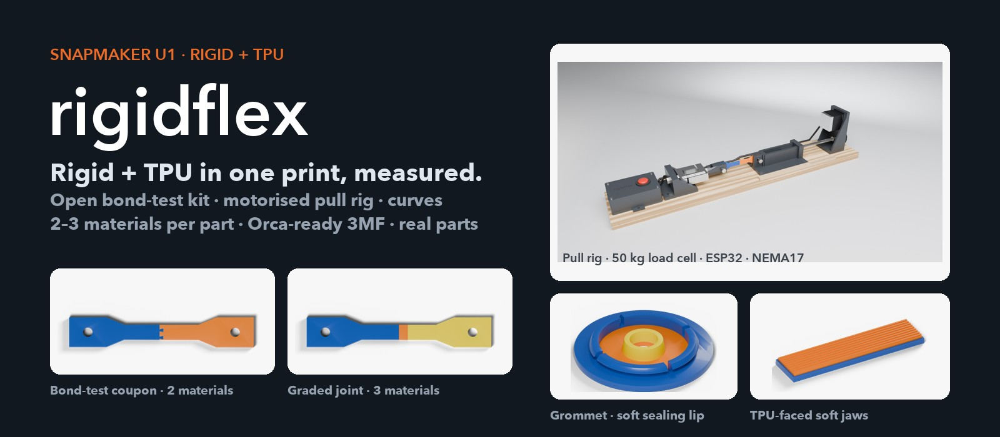</p>

# rigidflex

**Rigid + TPU in one print on the Snapmaker U1, measured.**

Lots of useful parts are rigid with a soft section: grommets, cable pass-throughs, boots, gaskets, grips, feet, padded fixtures. The U1 can print up to four materials in the same part, each from its own hotend. Owners keep asking the same question, and nobody has answered it with numbers yet:

> **Will TPU stay bonded to PLA, PETG or ASA, and which settings (and how many materials) make it hold?**

rigidflex is an open kit for answering that question, and for turning the answer into parts people can print.

### ▶ [Try the configurator in your browser](https://garage78.github.io/rigidflex/)

Pick a grommet, soft jaws or a plate of test coupons, set your sizes, and download a 3MF with every material already on its U1 toolhead. It runs this repository's own OpenSCAD files in the browser (official OpenSCAD WebAssembly build); nothing is installed or uploaded.

| | What | Status |
|---|---|---|
| 🌐 | **[Browser configurator](https://garage78.github.io/rigidflex/):** grommets, soft jaws and coupons with live 3D, section and exploded views, and a U1-ready 3MF download | ✅ live; files checked in OrcaSlicer |
| 🧪 | **Bond-test coupons:** parametric dog-bones; in-layer, lap and **graded three-material** joints | ✅ designed |
| 🔧 | **Motorised pull-test rig:** 50 kg load cell, ESP32, NEMA17, about 75–100 € of parts; records full force–extension curves | ✅ designed, sized, firmware written and tested in simulation |
| ⚙️ | **`rigidflex plan`:** the whole campaign (10 plates, 180 coupons, a pre-filled results sheet, a print log and a checklist) in one command | ✅ working |
| 🖨️ | **`rigidflex kit`:** U1-ready 3MF files with two or three materials (coupons, grommets, soft jaws) and the rig's parts | ✅ working; parts and extruders survive a round trip through OrcaSlicer 2.5 |
| 📈 | **`rigidflex test`:** guided testing that pulls each coupon, saves its curve and fills in the sheet; plus `plot` and `stiffness` | ✅ working (with `--simulate` until the rig is built) |
| 📊 | **`rigidflex analyze` / `advise`:** mean ± SD, 95 % CI, failure modes, energy; best settings for your material, also after heat | ✅ working; `advise` waits for U1 data |
| 📦 | **Dataset:** PLA, PETG and ASA with TPU 95A and 85A, every raw curve and value | ⏳ needs a U1 |
| ♻️ | **Waste and time per plate,** U1 vs a single-nozzle printer with a filament changer | ⏳ needs a U1 |
| 🎛️ | **Snapmaker Orca profiles** for rigid + TPU parts | ⏳ needs a U1 |
| 🚙 | **Real parts on classic vehicles:** grommets, boots and seals, fitted and water-tested | ⏳ needs a U1 |

Everything is free: code and firmware under MIT, and models, data and docs under CC BY 4.0.

---

## The coupons

<p>
 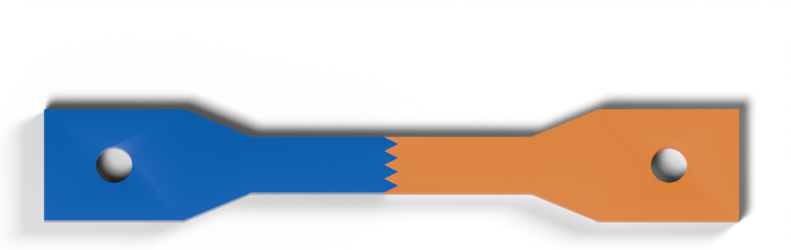 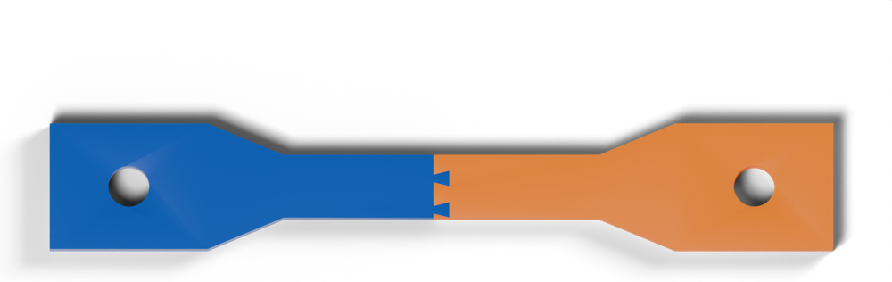
</p>

- **Coupon A (in-layer bond).** Rigid and TPU sit side by side in the same layers and meet at a butt joint. The joint is `flat`, `sawtooth`, `dovetail`, or `orca-beam` (flat geometry plus Orca's own beam interlocking at the interface).
- **Coupon B (layer bond).** A lap joint with TPU printed on top of the rigid material, or the other way round, with a 10 or 20 mm overlap.
- **Coupon G (graded, three materials).** Rigid, then a 6 mm band of TPU 95A, then soft TPU 85A. It is compared with rigid joined straight to 85A. It answers whether a stiffness step in between helps a soft part hold. Only a toolchanger can print it without purging twice per layer.

<p>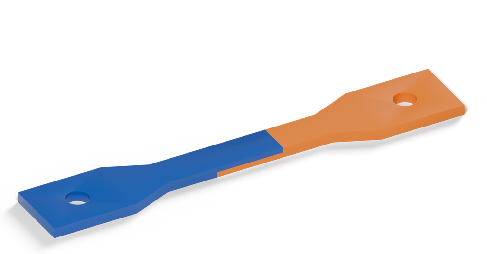 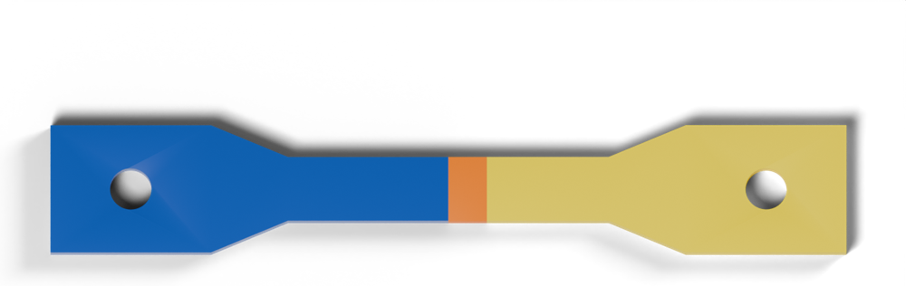</p>

All of them are **dog-bones**: 20 mm wide grips with M6 pin holes, and a 10 × 3 mm gauge section with the joint in the middle. They fail at the joint, not at the pin, and the forces stay within a 50 kg load cell. They print flat, with no supports.

## The rig

<p align="center">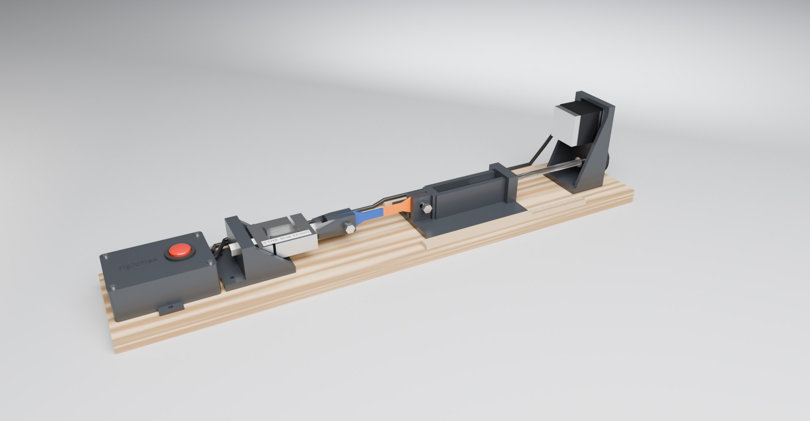</p>

A small motorised tensile tester:
- **Load path:** a 50 kg S-type load cell hangs from an anchor wall, and the coupon is pinned between two forks so it lines itself up with the pull.
- **Drive:** a NEMA17 turns a **self-locking T8 × 2 mm lead screw** through a 3:1 belt, at a **constant 2 mm/s**.
- **Electronics:** an **ESP32** generates the step pulses in hardware, reads the load cell 80 times a second, stops by itself when the coupon breaks, and streams the curve over USB.

Numbers:
- Highest load expected ≈ 360 N (TPU 95A at 100 % strain over 30 mm²).
- ≈ 2.5× torque margin, 81 mm of stroke.
- About 75–100 € of parts, six of them printed.

<p align="center">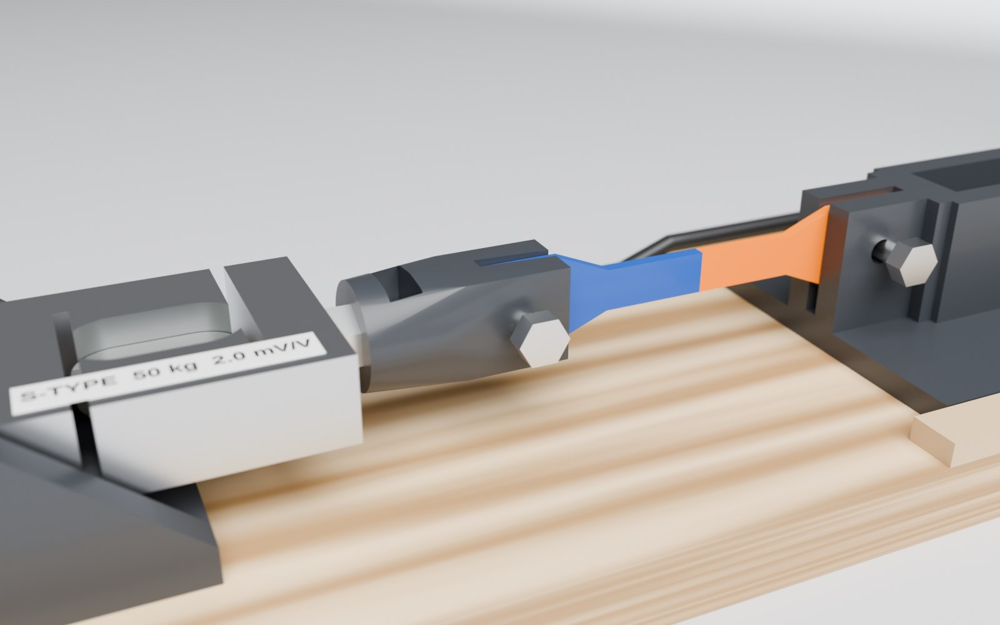 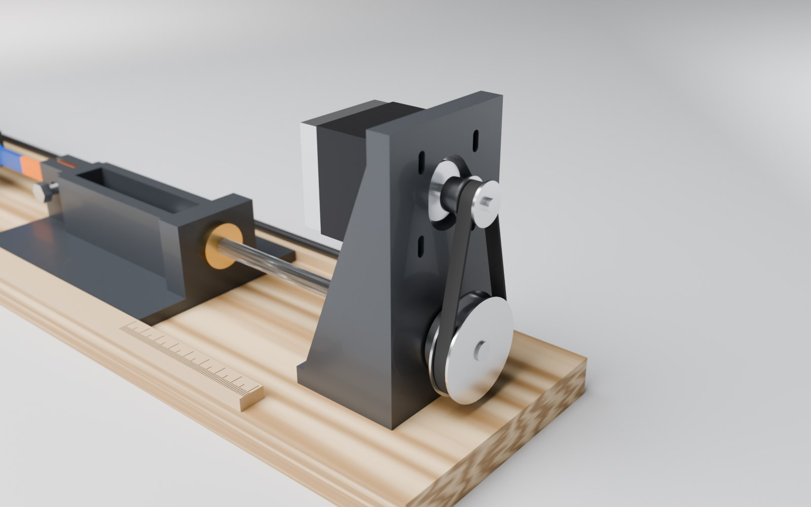</p>

The sizing table, bill of materials, wiring, assembly and calibration (force with known masses, rig stiffness with a steel dummy coupon) are in **[docs/pull_rig.md](docs/pull_rig.md)**. The firmware is in **[firmware/](firmware/)**.

## Test plan

| Series | Rigid | What varies | Coupons |
|---|---|---|---|
| **A** in-layer bond | PLA, PETG, ASA* | joint: flat / sawtooth / dovetail / Orca beam interlocking | 3 × 4 × 5 = 60 |
| **B** layer bond | PLA, PETG, ASA* | overlap 10 / 20 mm × print order (TPU on rigid / rigid on TPU) | 3 × 2 × 2 × 5 = 60 |
| **T** process | PETG, ASA* | TPU nozzle temperature 220 / 240 °C | 2 × 2 × 5 = 20 |
| **H** heat soak | PETG, ASA* | best A and B settings after 24 h at 80 °C (a car parked in the sun) | 2 × 2 × 5 = 20 |
| **G** graded | PETG, ASA* | rigid → TPU 85A directly, vs rigid → TPU 95A band → TPU 85A (**three extruders**) | 2 × 2 × 5 = 20 |
| **F** function | PETG, ASA* | grommets with two and three materials: 1 h under a 100 mm water column, then fitted on a vehicle | 6 parts |

*ASA is printed with the U1 top cover.

That makes **180 coupons plus 6 functional parts**. Every pull is saved as a full force–extension curve. Every plate gets its print time and weighed waste logged, next to what a single-nozzle printer with a filament changer would have purged for the same file. The method is in [docs/protocol.md](docs/protocol.md).

**Prediction, to be checked rather than promised:**
- PLA will not survive the heat soak.
- A mechanical joint will matter more than temperature.
- The graded joint will help the soft TPU.

If the data says otherwise, that gets published too.

## Why this needs a toolchanger

TPU is hard to push through the shared filament paths of a single-nozzle printer with a filament changer, and every swap means a purge. On the U1 each material has its own hotend and its own temperature, and switching is just a toolchange.

The settings tested here only exist on a toolchanger:
- per-tool temperature;
- print order at the interface;
- three materials in one part.

So the results apply to the U1 specifically. The print log puts a number on the material saved.

---

## Parts you can print today

<p>
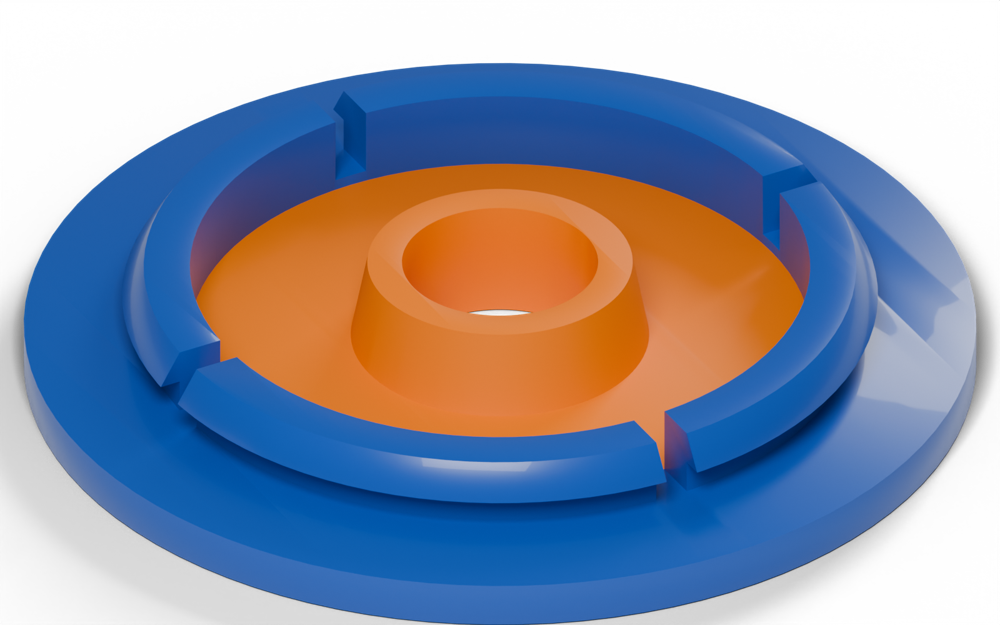 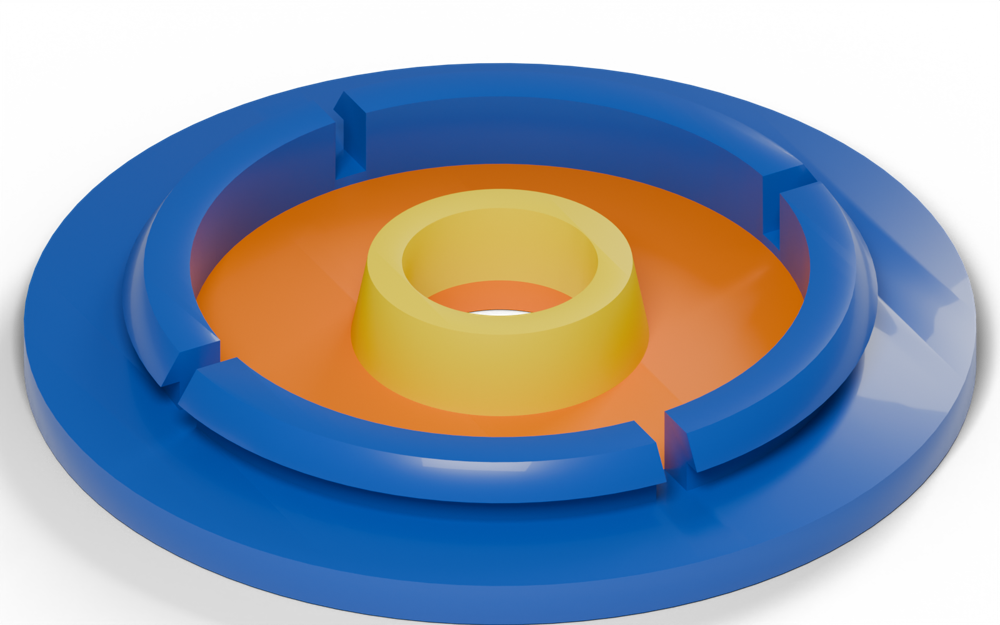 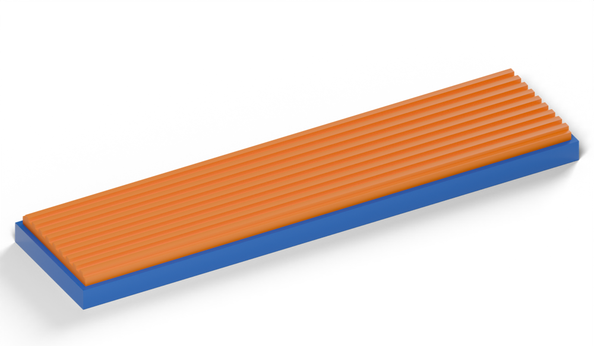
</p>

- **Grommet / cable pass-through, any size.** A rigid snap ring clips into the panel hole, and a TPU membrane seals around the cable with a 15 % interference fit. With `--three`, the sealing lip is printed in a softer TPU 85A on top of the 95A membrane. Set the cable diameter to 0 for a blanking plug.
- **Magnetic soft jaws for a vise.** A rigid plate with a TPU face, for holding painted, chromed or printed parts without marking them. The TPU is printed on top of the rigid plate (the series B bond) and also keys into grooves.

## Using the tools

Requirements: Python 3.10+ and [OpenSCAD](https://openscad.org). There are no Python dependencies, except `pyserial` to talk to the real rig.

```bash
git clone https://github.com/garage78/rigidflex && cd rigidflex
pip install -e .                      # or run it in place: python3 -m rigidflex ...

# the whole campaign: 10 plates + results.csv (180 rows) + print_log.csv + checklist.md
rigidflex plan -o campaign/

# single files (rigid on extruder 1, TPU 95A on 2, TPU 85A on 3)
rigidflex kit coupon --type A --joint dovetail
rigidflex kit coupon --type B --overlap 10 --order rigid-on-tpu
rigidflex kit coupon --type G --joint graded            # three materials
rigidflex kit grommet --hole 25 --panel 1.2 --cable 8 [--three]
rigidflex kit softjaw --width 100 --height 25
rigidflex kit rig -o rig/                               # printable STLs of the pull-test rig

# testing (pip install pyserial); add --simulate to try it all without hardware
rigidflex rig --port /dev/cu.usbserial-0001 info        # also: tare, cal 98.07, read, jog 5, watch 5
rigidflex stiffness --port /dev/cu.usbserial-0001       # once, with the steel dummy coupon
rigidflex test campaign/results.csv --port /dev/cu.usbserial-0001 --rig-stiffness 900

# results
rigidflex analyze campaign/results.csv --plates campaign/print_log.csv
rigidflex plot campaign/curves/A_PETG*.csv -o A_PETG.svg
rigidflex advise campaign/results.csv --rigid PETG [--heat]
```

`kit` writes 3MF projects in Orca's own format. Each object holds named parts already assigned to their extruders, so you only pick filaments and slice. On the `orca-beam` coupons, Orca's beam interlocking is switched on for that object. All of this has been checked by opening the files in OrcaSlicer 2.5 and saving them again: the parts, extruders and setting survive. Use `--rigid-tool`, `--tpu-tool` and `--soft-tool` to change the mapping.

Your own material pair adds to the dataset: print the plates, pull the coupons, and open a pull request with the CSV and the curves.

```bash
python3 -m unittest discover -s tests -t .   # tests: Python, models, 3MF, firmware logic (C++)
python3 scripts/render_images.py             # regenerate the part images (Blender + Pillow)
python3 scripts/render_rig.py                # regenerate the rig renders
```

## Repository layout

```
scad/        coupons, grommet, soft jaw, pull-test rig (parametric OpenSCAD)
rigidflex/   CLI: plan, kit, rig, stiffness, test, plot, analyze, advise; dependency-free 3MF writer
firmware/    ESP32 sketch for the rig, with its logic in a hardware-free header
web/         browser configurator (OpenSCAD WebAssembly + three.js), published with GitHub Pages
docs/        test protocol; rig sizing, BOM, wiring, assembly, calibration
data/        results and calibration templates; the U1 dataset goes here
tests/       unit tests (the fixture CSV is synthetic, not measured data)
scripts/     image rendering (OpenSCAD + Blender)
img/         renders
```

## Roadmap (about 3 months from receiving a U1)

- **Weeks 1–4:** build and calibrate the rig, print the campaign, run series A and B with PLA and PETG, and post the first curves.
- **Weeks 5–8:** run the ASA series with the top cover, the heat soak and the graded series G; publish the Snapmaker Orca profiles and fill `advise` with validated data.
- **Weeks 9–12:** run the grommet water tests, fit parts on classic vehicles, and write the final report with the waste comparison.

Progress is posted in the Snapmaker forum thread as it happens.

## About

I'm a maker with a PhD in computer engineering and a research background, which is why the data comes with its method. I restore classic vehicles in my own workshop, with welding, plasma cutting, a laser cutter and paint, and I print functional parts every week.

## License

- Code and firmware (`rigidflex/`, `firmware/`, `web/`, `tests/`, `scripts/`): [MIT](LICENSE)
- Bundled third-party code in `web/vendor/`: OpenSCAD (GPL-2.0-or-later, unmodified official build) and three.js (MIT); see the notes there
- Models (`scad/`), data (`data/`), docs and images: [CC BY 4.0](LICENSE-CC-BY-4.0.md), © garage78

No vehicle manufacturer logos are included in any model.
