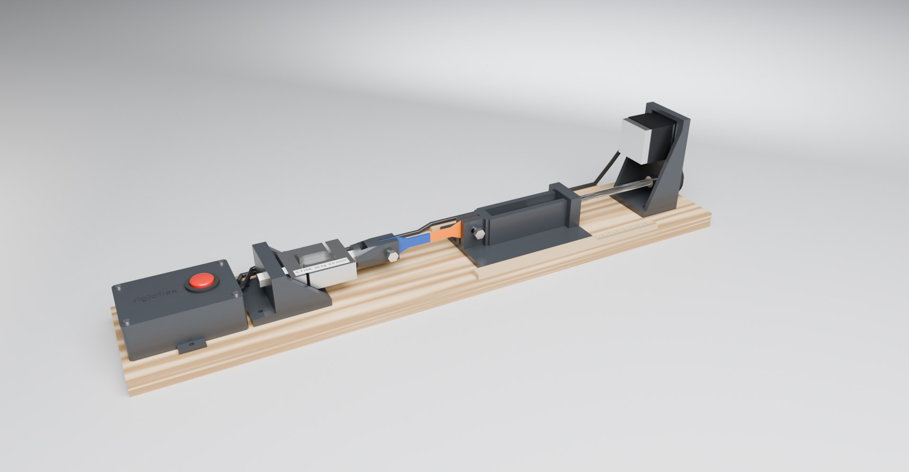
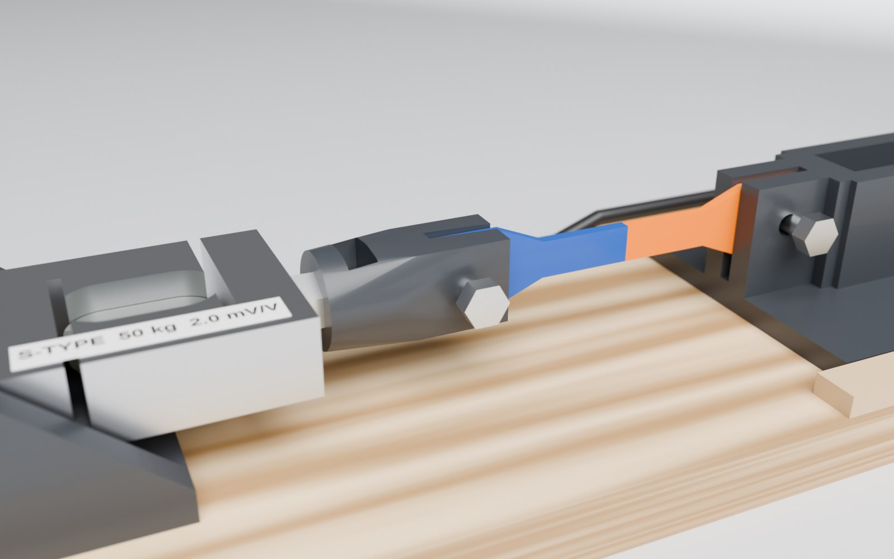
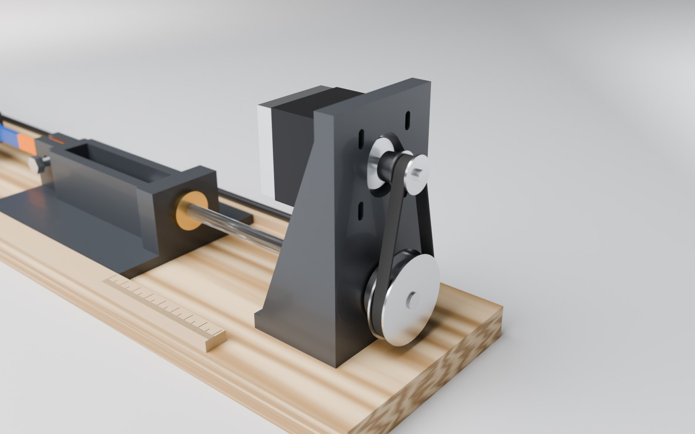

# Pull-test rig

<p align="center"></p>
<p align="center"> </p>

A small motorised tensile tester for the rigidflex coupons. It records the **whole force–extension curve** of every pull, not just the peak, at a constant speed set by a stepper motor.

What goes into it:
- Six printed parts.
- A 50 kg S-type load cell.
- An ESP32, a TMC2209 driver and a NEMA17 motor.
- About **75–100 € of parts** in total, less if you have a spare printer motor.

Source: [`scad/pull_rig.scad`](../scad/pull_rig.scad). Export the printable parts with `rigidflex kit rig`. Firmware: [`firmware/rigidflex_rig/`](../firmware/rigidflex_rig/).

## How it works

```
anchor ─ M8 ─ LOAD CELL ─ M8 ─ free fork ─ COUPON ─ fork on carriage ─ carriage ─ brass nut
                                                                                    │ T8 x 2 mm lead screw
                                         NEMA17 ─ 20T ── GT2 belt (3:1) ── 60T ─────┘ (608 bearing)
```

- The **load cell** hangs between the anchor wall and the free fork, so it sees only the pull.
- **Pinned forks** at both ends (M6 bolts through the coupon holes) let the coupon line itself up with the pull, so it is never bent.
- The **carriage** slides between two plywood guide strips. A self-locking T8 lead screw with a 2 mm lead drives it, turned by the NEMA17 through a 3:1 GT2 belt.
- The **ESP32** generates the step pulses from a hardware PWM channel, so the speed is exact. It reads the HX711 80 times a second and streams `time, extension, force` over USB.
- **When to stop:**
  - The ESP32 stops on its own when the coupon breaks (the force falls below 25 % of the peak), when the set travel is reached, or before the cell's rating.
  - The red button stops it at any time.
- **`rigidflex test`** on the laptop drives the session. It saves each curve, works out the numbers and fills in the results sheet.

## Sizing

| Check | Value | Margin |
|---|---|---|
| Highest load expected | TPU 95A at 100 % strain ≈ 10–12 MPa × 30 mm² (10 × 3 mm section) ≈ **300–360 N**. The test stops there (see the protocol). | 50 kg cell = 490 N rated, 735 N safe overload. The firmware stops at 470 N. |
| Force resolution | 2 mV/V cell, HX711 at gain 128 and 80 samples/s: noise in the order of **0.1 N** in practice. Check it with `rigidflex rig watch 5`. | under 0.1 % of a typical bond failure (100–300 N) |
| Peak capture | the force rises ≈ 20 N/s at 2 mm/s, so between two samples (12.5 ms) the peak moves ≈ 0.25 N | fine |
| Speed | hardware PWM at 4800 Hz for 2 mm/s (2400 steps/mm). Exact to the crystal, no hand-cranking. | — |
| Position | 0.42 µm per microstep, counted from the commanded steps. The rig's own deflection is measured once and subtracted (see the protocol). | — |
| Lead screw | T8, 2 mm lead. Lead angle 5.2° < friction angle ≈ 8.5° (steel/brass, μ ≈ 0.15), so it is **self-locking** and holds the load with the motor off. | — |
| Motor torque | screw torque = F·L / (2π·η) = 360 × 0.002 / (2π × 0.3) ≈ 0.38 N·m. Through the 3:1 belt (η ≈ 0.95) that is **≈ 0.13 N·m at the motor**, at 180 rpm. | a 48 mm NEMA17 gives ≈ 0.3–0.35 N·m at 180 rpm on 12 V: ≈ 2.5× |
| Belt | tight side ≈ 0.13 N·m / 6.4 mm ≈ 21 N | GT2 6 mm: > 5× |
| 608 bearing, axial | ≈ 0.5 × C0 = 0.5 × 1.37 kN ≈ 680 N static. The pull goes through the 60T pulley hub into the inner race, and the plate's shoulder takes it. | 1.9× |
| M6 pins (8.8, double shear) | ≈ 2 × 0.6 × 800 MPa × 20.1 mm² ≈ 19 kN | ≫ 10× |
| Printed fork ears (PETG) | bearing stress 360 / (2 × 7 × 6.4) ≈ 4 MPa vs ≈ 50 MPa | > 10× |
| Anchor | moment 360 N × 26 mm ≈ 9.4 N·m, taken by the gussets and 4 wood screws (≈ 190 N pull-out on the rear pair) | > 5× |
| Stroke | ≈ 81 mm available. Needed: ≈ 37 mm of TPU at 100 % strain + slack ≈ 45 mm. | 1.8× |
| Test speed | 2 mm/s = 120 mm/min, within the 50–500 mm/min used for plastic tensile tests | — |

## Bill of materials

| Part | Qty | Approx. price | Notes |
|---|---|---|---|
| **S-type load cell, 50 kg**, 2 mV/V | 1 | 15–25 € | Usually M8 threads; set `lc_thread` and the body size in `pull_rig.scad` to match yours. |
| **HX711** load-cell amplifier | 1 | 3–10 € | For 80 samples/s the RATE pin must be high. Use a board with a RATE jumper, or lift pin 15 off its ground trace and tie it to VCC. At the default 10 samples/s it still works, with a coarser curve. |
| **ESP32 DevKit** (30 or 38 pin) | 1 | 6–9 € | |
| **TMC2209** driver module (standalone STEP/DIR) | 1 | 4–7 € | quiet; MS1 = MS2 = GND gives 1/8 microstepping |
| **NEMA17**, 48 mm, ≥ 0.45 N·m holding | 1 | 10–14 € | a spare printer motor works |
| GT2 pulleys: 20T bore 5 mm + 60T bore 8 mm, for 6 mm belt | 1 + 1 | 6–9 € | |
| GT2 closed belt, 200 mm, 6 mm wide | 1 | 2 € | centre distance 58.6 mm; the motor slots give ±2.5 mm to tension it |
| **T8 lead screw, 200 mm, lead 2 mm** + brass flange nut | 1 | 8–12 € | Check that the lead is **2 mm**: the common lead-8 screw is not self-locking. |
| 608ZZ bearing, T8 shaft collar | 1 + 1 | 2 € | |
| 12 V 2 A power supply + 5.5 × 2.1 mm panel jack, 100 µF 25 V capacitor | 1 | 7–9 € | |
| 24 mm momentary push button | 1 | 2 € | stop |
| Microswitch (KW12 type) | 1 | 1 € | optional end stop at the motor end |
| 70 × 50 mm perfboard, pin headers, wire | 1 | 3 € | |
| M8 × 30 bolt, 2 M8 nuts, 40 mm of M8 threaded rod | — | 2 € | load cell |
| M6 × 30 bolts + nuts | 2 | 1 € | coupon pins |
| M3 × 10 screws | 12 | 1 € | motor, brass nut, lid |
| Wood screws 4 × 30 | 16 | — | |
| Board ≈ 650 × 120 × 18 mm, two 6 mm plywood strips ≈ 230 × 12 mm | — | — | Laser-cut or sawn. Engrave the 1 mm scale on the front strip. |

**Total: about 75–100 €.**

## Wiring

| From | To | Notes |
|---|---|---|
| Load cell red / black / green / white | HX711 E+ / E− / A+ / A− | Colours vary by maker. If the force reads negative, calibration handles it. |
| HX711 VCC / GND / DT / SCK | ESP32 3V3 / GND / **GPIO19** / **GPIO18** | |
| TMC2209 VIO / GND | ESP32 3V3 / GND | |
| TMC2209 STEP / DIR / EN | **GPIO25** / **GPIO26** / **GPIO27** | |
| TMC2209 MS1, MS2 | GND | 1/8 microstepping |
| TMC2209 VM / GND | 12 V jack + / − | Put the 100 µF capacitor right at VM. **Never unplug the motor with VM on.** |
| TMC2209 A1 A2 B1 B2 | motor coils | If the carriage moves the wrong way, swap one coil pair, or set `DIR_PULL = LOW` in the sketch. |
| Stop button | **GPIO33** ↔ GND | |
| End-stop microswitch (NO) | **GPIO32** ↔ GND | optional |
| ESP32 USB | laptop | power and data |

Set the motor current with the driver's Vref potentiometer to about 70 % of the motor's rated current, using your driver module's formula.

## Printing

PETG or ASA, 0.2 mm layers, **5 walls, 40 % infill**. Every part is exported in its print orientation, with no supports. The bearing and motor holes are teardrops so they bridge cleanly.

## Assembly

1. **Measure and export.** Measure your load cell and motor. Set the `[Load cell]` values in `pull_rig.scad`, then run `rigidflex kit rig`.
2. **Guide strips.** Screw them along the board edges.
3. **Load cell.** Screw the anchor to the board, then bolt the load cell to it with the M8 bolt and a jam nut. Thread the M8 rod into the cell's free end, with a jam nut, and screw the fork onto it with its captive nut. Keep the fork's slot vertical.
4. **Drive.**
   - Press the 608 into the motor end from the outside and screw the block to the board.
   - Run the lead screw through the carriage nut and the bearing. Put the collar on the inside and the 60T pulley on the outside, pressed against the bearing's inner race.
   - Bolt the motor into its pocket from the outside (4 × M3 in the slots). Fit the 20T pulley and the belt, then slide the motor up to tension the belt.
5. **Electronics.** Solder the ESP32, TMC2209 and HX711 on the perfboard, screw the board into the box, and run the cables through the glands.
6. **Firmware.** Flash `firmware/rigidflex_rig/` with the Arduino IDE (board *ESP32 Dev Module*; no extra libraries).
7. **First checks** (`pip install pyserial`):
   ```bash
   rigidflex rig --port /dev/cu.usbserial-0001 info
   rigidflex rig --port /dev/cu.usbserial-0001 jog 5      # the carriage must move away from the load cell
   rigidflex rig --port /dev/cu.usbserial-0001 jog -5
   ```

## Calibration

**Force.** Do this once, then check it every 50 tests:

1. Clamp the board vertically to a table leg or post, with the load cell at the top and the fork hanging free. Remove the coupon.
2. `rigidflex rig --port … tare`
3. Hang a known mass from the fork's pin, for example a bucket of water weighed on a kitchen scale, about 10 kg. Then run `rigidflex rig --port … cal 98.07`, giving the newtons for your mass (kg × 9.807).
4. Check with two other masses using `rigidflex rig --port … read`, and write them into `data/calibration.csv`. Recalibrate if the error is above 1 %.

**Rig stiffness.** Do this once:
1. Pin in a dummy coupon made of steel flat bar: 20 × 3 mm, two 6.5 mm holes 99 mm apart.
2. Run `rigidflex stiffness --port …`. It pulls 2 mm at 0.5 mm/s and prints the rig's own stiffness (N/mm).
3. Pass that value to `rigidflex test --rig-stiffness …`. Every curve then has the rig's deflection removed.
